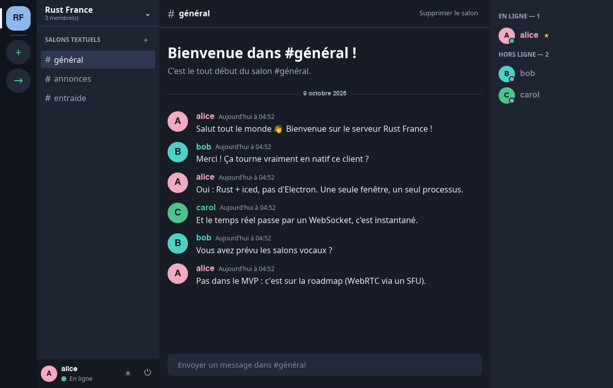

# Plume Lite

**The simplest possible self-hosted alternative to Discord.** A desktop client in Rust +
[iced](https://iced.rs) (no web engine, a single process), a Rust server (axum) whose database fits
in a single SQLite file, and real time over WebSocket.

The application itself is in French (its screens and messages); the code and this documentation are
in English.



## What Plume Lite does

- Accounts: sign-up **with an invitation code** given by the administrator, login, session
  remembered on the device; password change and list of logged-in devices, with remote logout
  (the ⚙ Paramètres window).
- Servers ("guilds"): creation, renaming, invitations by code (limited uses and lifetime), leaving,
  kicking, banning (with the list of banned users), ownership transfer confirmed by the password,
  deletion.
- Coloured, ranked roles with thirteen permissions (manage the server, channels, roles, messages;
  view the audit log, see channels, write, invite, kick, ban, mention @everyone, mute, move in
  voice); one only manages what ranks below one's own role, and only hands out permissions one has.
- Private channels and read-only channels: per role, see and write (inherit, allow, deny); a
  channel one cannot see appears nowhere (list, search, unread markers, voice, real time).
- An audit log of moderation (90 days), and a welcome announcement for new members in a chosen
  channel, with a welcome message.
- Text and voice channels: creation, renaming, deletion, order and collapsible categories
  (permission "manage channels"), normalised names.
- **Voice channels**: you see who is in and who is speaking; mute your microphone and your sound,
  choice of microphone and speakers, adjustable sensitivity, noise suppression and echo
  cancellation, Opus at 128 kbit/s, join and leave chimes; moderators can mute someone, move them to
  another voice channel or take them out of voice. The sound goes through a self-hosted
  [LiveKit](https://livekit.io) server.
- Real-time messages: optimistic sending, editing, deletion (author or moderators), history paged as
  you scroll.
- Rich messages: up to 4,000 characters over several lines, Discord-style Markdown (bold, italic,
  code, quotes, headings, lists, spoilers, links), replies, `@name` mentions with suggestions and
  `@everyone` for those who may; messages that concern you are highlighted.
- Search in a server's messages, insensitive to accents, with `de:name` (from) and `dans:#channel`
  (in) filters.
- Emoji reactions (who reacted shows on hover) and messages pinned by moderators, with their list
  per channel.
- Online/offline presence, a "is typing…" indicator, drafts per channel.
- Unread markers kept by the server and synchronised between your devices, with the number of
  mentions per channel and per server; system notifications (all messages, mentions only or nothing,
  per server or per channel), a "Ne pas déranger" (do not disturb) mode; a notification-area icon on
  Windows and Linux (closing the window lets Plume Lite keep notifying you).
- Automatic reconnection (exponential backoff + jitter) with a full resynchronisation.
- A light blue and pink theme by default, a dark theme in one click (button next to logout).
- Windows and Linux (x86-64) clients downloadable from the server's home page, with their SHA-256
  and their minisign signature; the client downloads its updates, checks their hash and signature
  with the public key it embeds, and only then keeps them.
- Verified build: GitHub actions pinned by SHA, the voice engine's prebuilt libwebrtc checked against
  a SHA-256 pinned in the repository, weekly dependency audit and secret scan.
- The client tells you when a new version is available.
- Administration by commands on the server (registration codes, accounts, passwords) and a daily
  backup of the database.

## Quick start

Prerequisites: Rust ≥ 1.94 (`rustup`) and Docker (for the voice server). On Linux, the client's
voice engine (WebRTC) is built with clang 21 or newer and the glib headers, and its sounds with
ALSA's; on Ubuntu 24.04 and derivatives, clang 21 comes from LLVM's official repository:

```bash
cd /tmp && wget https://apt.llvm.org/llvm.sh && sudo bash llvm.sh 21
```

```bash
sudo apt install libglib2.0-dev libasound2-dev
```

The database is created at first start in `data/plume-lite.db`. The first time, copy the development
configuration (it opens registration without a code, which must not be done in production):

```bash
cp .env.example .env
```

The development voice server, then the server:

```bash
docker compose up -d livekit
```

```bash
cargo run --release -p plume-lite-server
```

In another terminal:

```bash
cargo run --release -p plume-lite-client
```

Create an account on the login screen (default server: `http://127.0.0.1:8080`), or fill the server
with demo accounts and a demo conversation:

```bash
python3 scripts/seed_demo.py
```

For a second account on the same machine, use a separate profile:

```bash
PLUME_LITE_PROFILE=bob cargo run --release -p plume-lite-client
```

Software rendering (no GPU): `ICED_BACKEND=tiny-skia`.

To try voice alone in front of your screen, a windowless bot joins a voice channel, beeps every
three seconds and prints the volume at which it hears the others:

```bash
cargo run -p plume-lite-client --example voice_bot -- http://127.0.0.1:8080 bob motdepasse-demo <channel id>
```

## Tests

```bash
cargo test --workspace
```

98 tests: client reducers, the protocol (including channel order and the permission computation),
the ID generator, LiveKit tokens, the broadcast hub, rate limiting, and 24 **end-to-end** tests that
start the real server on a random port with a throw-away SQLite database per test (opened as in
production), then speak HTTP and WebSocket like a real client (authentication, registration codes,
administration commands, backups, password and devices, expiry of sessions and invitations,
permissions, categories and channel order, bans, ownership transfer, roles and hierarchy, private
channels, audit log and welcome, pagination, real time, presence, rate limiting, the download page,
voice against a fake LiveKit). Nothing to install. A real-call test (two participants, a real
LiveKit: one plays a tone, the other must hear it) is run separately, with the development stack
started:

```bash
cargo test -p plume-lite-client --test voice_call -- --ignored
```

The GitHub Actions CI (`.github/workflows/ci.yml`) runs `fmt`, `clippy -D warnings` and the tests on
every push, and every Monday `cargo audit` (vulnerable dependencies) and
[gitleaks](https://github.com/gitleaks/gitleaks) over the whole history (committed secrets). Its
actions are pinned by commit hash, and its token is read-only.

### Before committing

A hook refuses the commit if a secret is detected or if the code is not formatted. It needs
[gitleaks](https://github.com/gitleaks/gitleaks#installing) and is enabled once per clone:

```bash
git config core.hooksPath .githooks
```

To report a vulnerability, see [SECURITY.md](SECURITY.md).

## Measurements (release build, Linux x86_64)

| | Plume Lite |
|---|---|
| Client binary | 49.5 MB, a single file (including the voice WebRTC engine and 2.6 MB of fonts) |
| Server binary | 6.0 MB, SQLite included |
| Client memory (wgpu/Vulkan GPU rendering) | RSS 238 MB, of which **~54 MB of its own memory**; the rest is mostly the graphics driver's shared libraries |
| Server memory | ~28 MB (RSS) after filling it with demo data |

For comparison, the official Discord client (Electron) embeds Chromium and starts several
processes; its footprint is typically counted in hundreds of MB.

## Structure

```
crates/
  protocol/   shared client ⇄ server contract: IDs, models, REST DTOs, gateway frames, validation
  server/     REST API + WebSocket gateway (axum, sqlx, SQLite); migrations in server/migrations
  client/     iced desktop application (Elm architecture): app, store, api, gateway, view/;
              Noto fonts bundled in client/fonts (SIL OFL license)
deploy/       going online on the VPS (Docker, Caddy): instructions in deploy/README.md
docs/
  ARCHITECTURE.md   decisions, flows, data model, security, roadmap
  API.md            REST and gateway reference
```

## Server configuration

Environment variables, all optional (see `.env.example`): `DATABASE_PATH`, `BIND_ADDR`,
`SESSION_TTL_DAYS`, `TRUST_PROXY`, `RATE_LIMIT`, `OPEN_REGISTRATION` (development only),
`BACKUP_DIR`, `BACKUP_KEEP`, `DOWNLOADS_DIR`, `RUST_LOG`. Migrations are embedded and applied at
start-up.

The same binary is used for administration, for example to create a registration code:

```bash
cargo run --release -p plume-lite-server -- invite
```

`cargo run --release -p plume-lite-server -- help` lists all the commands.

## Deployment

The GitHub **Release** workflow, triggered by a `v<version>` tag, builds the Windows and Linux
clients, puts them in the server's Docker image and publishes it to GitHub's container registry.
Going online on the VPS (Docker, Caddy, domain name, administration, backups, updates) is described
step by step in [deploy/README.md](deploy/README.md).

To try the image locally:

```bash
docker compose up -d --build
```

## Approach

Plume Lite started under the name Miniscord, an exercise in designing a complete chat application,
end to end, with a native client in Rust rather than Electron. I wrote the specification: a
startup-style MVP, with its architecture, data model, API, interface and code. I developed the
project with the assistance of **Claude** (Anthropic), used as a pair-programming partner. Every
commit message ends with a line saying it was developed with Claude, for that reason.

I then turned it into something I really use: the simplest possible application, hosted on my own
VPS for my friends and me. I drew up the complete list of features and decided what to keep (for
example, nothing that animates by itself, to preserve performance), chose the visual identity, and
arbitrated the technical choices: SQLite rather than PostgreSQL (no database server to run on a
shared VPS), administration by commands rather than a web panel. Since then, I have planned the
roadmap in small releases (voice, rich messages, notifications, search, roles, private channels,
audit log), asked for security to come first in every choice, and tested and deployed each version
myself.

The code was written with Claude, then checked: 98 tests, 24 of them end-to-end with a real SQLite
database and a real WebSocket, strict static analysis, a Docker image built and run, a weekly
dependency audit and secret scan, and trials of the interface with several accounts logged in at
the same time. The architecture decisions and their alternatives are documented in
[ARCHITECTURE.md](docs/ARCHITECTURE.md).

## License

[MIT](LICENSE).

## Documentation

- [Architecture](docs/ARCHITECTURE.md)
- [REST API and gateway](docs/API.md)
- [Deployment](deploy/README.md)
- [Security policy](SECURITY.md)
