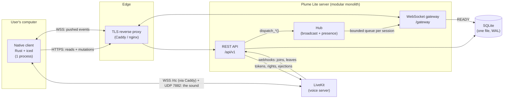
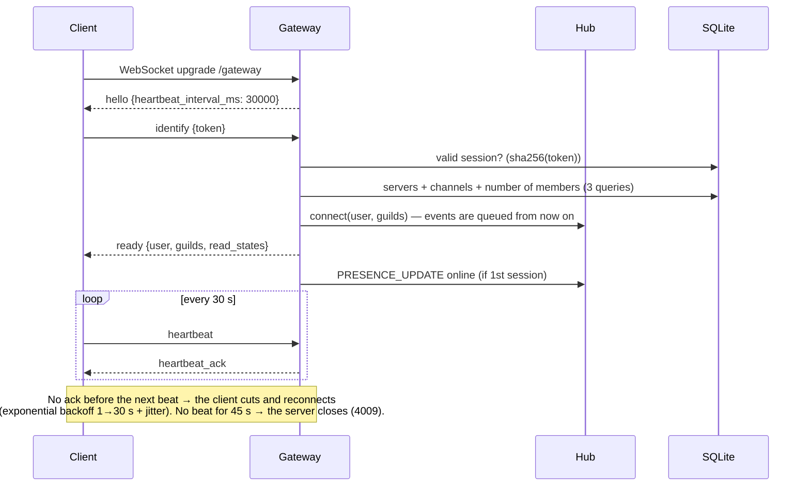
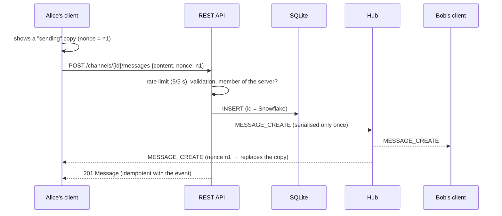
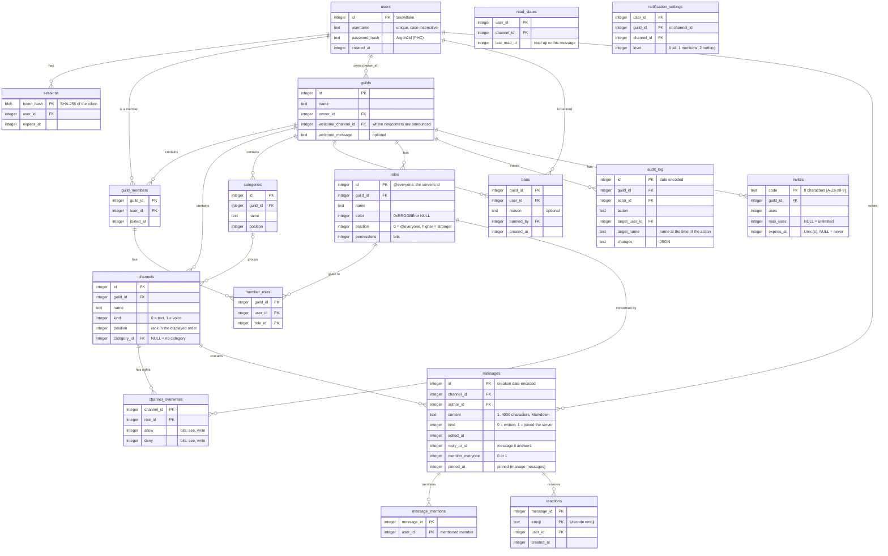

# Plume Lite architecture

> The simplest possible alternative to Discord: a **native** client (Rust + iced, no web engine)
> and a Rust server (axum) self-hosted on a small VPS, with its database in **a single SQLite
> file**. Meant for a group of friends or a small community, not for millions of users.

## 1. Goals and constraints

| Requirement | MVP target | How it is reached |
|---|---|---|
| Client footprint | A single process, ~50 MB of its own memory | Native rendering (iced/wgpu), no Chromium, bounded cache |
| Real-time latency | < 100 ms end to end | Persistent WebSocket, events serialised only once |
| Ease of operation | 1 binary + 1 database file | A single process, embedded SQLite, embedded migrations, 12-factor config |
| Baseline security | "Production" level | Argon2id, hashed opaque tokens, rate limiting, shared validation |
| Hosting | A small VPS shared with other sites (2 vCPU, 4 GB) | A server of ~30 MB of RAM, no database server alongside |

Not done yet (see the [roadmap](#13-roadmap)): video and screen sharing, direct messages, file
attachments.

## 2. Overview



**Guiding principle (the same as Discord's):** all mutations go through REST (simple to validate,
to limit, to replay, to test), and the WebSocket is only used to **push** the consequences to the
clients concerned. The client only sends `identify` and `heartbeat` on the gateway.

## 3. Code organisation

```
plume-lite/
├── Cargo.toml                 # workspace (shared versions, lints, profiles)
├── crates/
│   ├── protocol/              # client ⇄ server contract, shared at compile time
│   │   └── src/{snowflake,model,http,gateway,layout,permissions,validate}.rs
│   ├── server/
│   │   ├── migrations/        # versioned SQL, embedded in the binary
│   │   ├── src/
│   │   │   ├── main.rs        # wiring: config, pool, migrations, graceful shutdown
│   │   │   ├── lib.rs         # application reused as is by the tests
│   │   │   ├── routes/        # thin HTTP handlers (validation → db → hub)
│   │   │   ├── db/            # SQL per aggregate, no ORM, no N+1
│   │   │   ├── gateway/       # WebSocket session + broadcast/presence hub
│   │   │   ├── auth.rs        # Argon2id, tokens, AuthUser extractor
│   │   │   ├── admin.rs       # administration commands (invite, users, reset-password…)
│   │   │   ├── backup.rs      # daily backups (VACUUM INTO)
│   │   │   ├── voice/         # voice: LiveKit tokens (JWT HS256), who is where, calls to LiveKit
│   │   │   ├── ids.rs         # lock-free Snowflake generator
│   │   │   ├── rate_limit.rs  # token buckets
│   │   │   └── error.rs       # single error envelope
│   │   └── tests/api.rs       # end-to-end tests (real HTTP + WebSocket)
│   └── client/
│       └── src/
│           ├── main.rs        # iced start-up
│           ├── app.rs         # state machine (Elm architecture)
│           ├── store.rs       # normalised cache + pure reducers (tested)
│           ├── api.rs         # typed REST client
│           ├── gateway.rs     # real-time connection (iced Subscription)
│           ├── voice.rs       # calls: LiveKit room, microphone and speakers (iced Subscription)
│           ├── session.rs     # session (0600 file) and persisted preferences
│           ├── theme.rs       # light (default) and dark themes, styles
│           └── view/          # pure rendering: login, sidebar, chat, members, modal, settings
├── deploy/                    # going online on the VPS: compose, Caddy, instructions
└── docs/
```

The **`protocol`** crate is the keystone: models, REST DTOs, gateway frames, error codes and
validation rules are defined **once**. A format change that breaks the client breaks the
compilation, not production.

## 4. Architecture decisions

| # | Decision | Alternatives ruled out | Reason |
|---|---|---|---|
| 1 | **Rust end to end** + shared `protocol` crate | TS on the server side | A single language, a contract checked by the compiler, lean binaries |
| 2 | Client **iced 0.14** (Elm architecture, wgpu rendering with tiny-skia software fallback) | Tauri (WebView), egui, Slint, gpui | Native without a WebView; predictable and testable Elm model; used in production (COSMIC); MIT license |
| 3 | Server **axum 0.8** on tokio | actix-web | tower ecosystem (middlewares), built-in WebSocket, ergonomics |
| 4 | **SQLite** (WAL) + **sqlx** (explicit SQL) | PostgreSQL, ORM, MongoDB | No database server to run, secure or update; a few MB of RAM on a shared VPS; backup = one file; transactions, foreign keys, `STRICT` tables, composite indexes. A single writer at a time, that is thousands of writes per second: plenty for an instance among friends |
| 5 | **Snowflake IDs** (64 bits, time-sortable) | UUID v4, auto-increment | Free cursor pagination, creation date encoded in the id, generated without a database round trip |
| 6 | **Opaque tokens** (256 bits, only the SHA-256 is stored) | JWT | Instant revocation (logout = `DELETE`), no signing secret to rotate; cost = 1 primary-key lookup |
| 7 | **REST to write, WebSocket to broadcast** | Everything over WebSocket | Rate limiting, HTTP codes, idempotence and trivial tests |
| 8 | **A single process** (separate modules inside) | Microservices | One binary to deploy and monitor; the code stays split by responsibility |
| 9 | **In-memory hub** behind a `dispatch_*` interface | Redis, NATS | A single instance by design: a message bus would bring nothing; a Rust server easily holds thousands of WebSockets |
| 10 | **Optimistic sending** with a `nonce` | Waiting for the response | Zero perceived latency; deterministic reconciliation |
| 11 | **READY = resynchronisation point** | Resuming with sequence numbers | Simpler and more robust for an MVP; resuming (`resume`) is on the roadmap |
| 12 | Self-hosted **LiveKit** + its official Rust SDK for voice | Pure-Rust WebRTC (str0m), home-made Opus over UDP, Mumble | A proven relay server (bitrate management, and video and screen sharing later); Chrome's audio engine (echo cancellation, noise suppression, device choice); one more container, ~100 MB. Cost: a heavier client (~46 MB) and clang 21 to build it on Linux |
| 13 | **Categories in a table of their own**, order computed by a single shared function (`protocol::layout`) | Category = a channel of a special kind (Discord) | An older client would have displayed a category as a text channel, and every channel access check would have had to exclude it (otherwise one could post in it); positions renumbered in the displayed order, hence readable by the older clients |
| 14 | **Permissions computed by a single shared function** (`protocol::permissions`), checked inside the write transaction for everything that touches roles; `@everyone` = a real role whose id is the server's | Checks written by hand in every handler | The client only displays what the server would accept, without duplicating the rule; a single line of computation to audit. Per-channel rights (private channels, 0.6.2) are built on the same function |

## 5. Main flows

### 5.1 Connecting to the gateway



### 5.2 Sending a message



All the client's reducers are **idempotent** (insertion sorted by id, de-duplication): it does not
matter in which order the REST response and the event arrive, or if an event is received twice
around a reconnection.

## 6. Data model



Indexes chosen for the queries actually run:

| Hot query | Index | Cost |
|---|---|---|
| Page of messages before/after X | `messages (channel_id, id DESC)` | 1 range scan, whatever the size of the history |
| A user's servers (READY) | `guild_members (user_id)` | O(number of servers) |
| A server's members (keyset pagination) | PK `(guild_id, user_id)` | No `OFFSET`, constant cost per page |
| Authentication | PK `sessions (token_hash)` | 1 lookup |
| Login by name | `username UNIQUE COLLATE NOCASE` | 1 lookup, case-insensitive |

Safeguards in the database (defence in depth): `STRICT` tables (a value of the wrong type is
refused), `CHECK` on lengths, cascading foreign keys, `max_uses > 0`. Dates are Unix timestamps in
seconds, compared with `unixepoch()`. Redeeming an invitation is an `UPDATE … WHERE uses <
max_uses RETURNING`: atomic, hence race-free.

## 7. The server

- **Layers:** `routes` (thin HTTP: extraction → validation → access check → `db` → `hub`); `db`
  (SQL per aggregate); `gateway` (sessions); `hub` (event routing).
- **Access control:** a single query loads a channel **and** checks membership
  (`db::channels::access`). A non-member gets **404** (not 403): it is impossible to probe the
  existence of a server or a channel.
- **Hub:** only knows the users who are **online** (`user → sessions + servers`, `server → online
  members`). Publishing costs O(online members). Each session has a bounded queue (512); a client
  that is too slow is disconnected (code 4008) and then resynchronises, instead of letting the
  server's memory swell.
- **Graceful shutdown:** SIGTERM → no new connections, the gateway sessions close with 1012
  ("restart") and the clients reconnect with backoff.
- **Background tasks:** purge of the rate-limiting buckets (1 min); every hour, purge of expired
  sessions and used-up registration codes, and a database backup if the last one is more than 23 h
  old (the last 7 are kept).
- **Revoked sessions:** REST refuses them at once; the real-time connection re-checks its token at
  every beat and closes (code 4004) within 30 s.

## 8. The client

**Elm** architecture (iced's): `state → Msg → update → (new state, Tasks) → view`.

- `App` is a state machine: `Restoring` (validating the saved token) → `Login` → `Chat`. An
  invalid session (401 or gateway code 4004) sends back to `Login`.
- `Store` is a **normalised cache** (servers, channels, timelines, members, presence, typing,
  unread markers) fed only by **pure reducers**, unit-tested.
- `gateway.rs` exposes the connection as an iced `Subscription` keyed by `(url, token)`: logging
  out destroys it, switching account creates a new one.
- **Memory thrift:** when leaving a channel, its timeline is truncated to 100 messages; the
  messages of channels never opened are not kept; the history loads in pages of 50 as you scroll.
- **Unread markers:** the server remembers where everyone stopped in each channel (`read_states`)
  and tells all their devices. The channel shown in an active window is read; the client sends it
  one second later (a burst of messages costs only one request). A channel is unread when its last
  message is newer; unread mentions are counted by the server at `READY`, then by the client (the
  same event received twice counts only once). The window title takes them up: "(3)" or "•".
- **UX:** optimistic sending with retry/give-up on failure, messages grouped by author (7-minute
  window), day separators, drafts per channel, typing indicator (8 s debounce), in-place editing
  (Enter/Escape), live presence.
- **Rich messages:** Markdown (`protocol::markup`) is parsed once per message and kept with the
  timeline, not at every frame. Multi-line input (Enter sends, Shift+Enter breaks the line); when
  typing `@`, the server's members are offered, and `@name` becomes `<@id>` on sending (the
  reverse when editing), never inside code. A message that mentions us, or that answers one of
  ours, is highlighted in pink.
- **Reactions:** each reaction is a set of users (not a counter): a `REACTION_ADD` received twice
  counts only once, and hovering shows who reacted. The click shows at once and an error, if any,
  undoes it. Choice among 32 common emojis (custom emojis will come with v0.7).
- **Notifications:** a new message triggers a system notification (the desktop's notification
  service over D-Bus on Linux, a toast on Windows) if its channel's setting wants it (channel,
  else server, else "all messages"; synchronised between devices), except for our own messages, in
  "Ne pas déranger" (do not disturb) mode (a per-device setting) or if the channel is already on
  screen. Inactive window: it asks for attention in the taskbar. The text is the plain message
  (mentions by name, spoilers hidden, 200 characters). On Windows, the name "Plume Lite" is
  declared for the current user (`HKCU\Software\Classes\AppUserModelId`), otherwise the toasts
  would carry PowerShell's name.
- **Search:** a SQLite full-text index (FTS5, external content: the text stays in `messages`),
  kept up to date by triggers on every creation, edit or deletion, cascades included. The search
  words only keep letters and digits and are looked up as word beginnings (`"ete"*`): nothing one
  types can be read as FTS5 syntax. In the client, `de:name` and `dans:#channel` become filters;
  the results replace the member list.
- **Notification area:** an icon (StatusNotifierItem over D-Bus on Linux, in pure Rust: KDE, XFCE,
  Cinnamon, MATE, GNOME with the AppIndicator extension; Windows' notification area). Closing the
  window hides it and Plume Lite keeps notifying; a click on the icon reopens it, its menu offers
  "Ne pas déranger" and "Quitter" (Quit). A pink dot on the icon signals unread messages. Without a
  notification area, closing the window quits, as before.
- **Embedded fonts:** Noto Sans (regular, italic, bold, bold italic) and Noto Sans Mono (~2.6 MB,
  OFL license in `crates/client/fonts/`). iced's default font, Open Sans, is rarely installed:
  without it, italics and code fell back to a fallback font, different from one system to another.
  cosmic-text 0.15 (iced's text engine) shapes an all-ASCII word with the font of its first
  letter: where a style starts or ends in the middle of a word (`l'*italic*`), the client inserts
  an invisible "word joiner" that makes it follow each change of font.
- **Stable widget tree:** an iced column ignores its empty children, and a widget that changes
  place loses its state (focus, scrolling). The optional parts placed before an input field
  (suggestions, reply, reconnection banner) are therefore wrapped in containers that are always
  present.

## 8 bis. Voice

The sound never goes through the Plume Lite server: each voice channel is a LiveKit room, named
after the channel's id, and everyone's identity in it is their user id.

1. **Joining:** the client asks `POST /channels/{id}/voice`. The server checks membership of the
   server (404 otherwise) and the channel's kind, then signs a LiveKit token (JWT HS256, secret
   shared with LiveKit) valid for 10 minutes for that room only. A member muted by moderators gets
   a token without the right to publish.
2. **Who is where:** LiveKit tells the server about every join and leave (signed webhook; the
   token carries the SHA-256 of the body). The server checks membership again (otherwise it ejects
   the intruder), keeps the state in memory and broadcasts it (`VOICE_STATE_UPDATE`); `READY` and
   `GUILD_CREATE` contain it. After a restart, it asks LiveKit again who is in which room.
3. **Microphone and sound:** the client applies them locally and signals them
   (`PATCH /users/@me/voice`) so that the others see "muet" (muted) or "son coupé" (sound off).
   Turning the sound off unsubscribes from all the tracks: one hears nothing and receives nothing.
4. **Moderation:** whoever has the permission can mute (LiveKit removes the right to publish; the
   client publishes the microphone again when it is given back), take someone out of voice or move
   them to another voice channel. A self-hosted LiveKit cannot move someone from one room to
   another (`MoveParticipant` is reserved to its hosted offer): the server sends `VOICE_MOVE` to
   the moved member only, whose client changes room as if they had clicked. Leaving the server,
   being kicked out of it, deleting the channel or the server also takes out of voice; a disabled
   account is ejected from all the rooms.

**On the client side:** the microphone and the speakers go through WebRTC's audio module
(`PlatformAudio`), with its echo cancellation and noise suppression. Voice activation cuts the
track when the microphone level stays under the chosen threshold (with a 400 ms hold); if the
system does not provide this level, the microphone simply stays open. Opus at 128 kbit/s, nothing
sent during silences (DTX), redundancy against losses (RED).

The join and leave chimes (two rising or falling notes) are synthesised by the client and played by
`cpal` on an output stream opened for the duration of the sound (WebRTC's audio module only plays
the call): on the chosen output when the system finds it under the same name, otherwise on the
default one. No sound when one has muted one's own.

## 9. Security

| Threat | Measure |
|---|---|
| Database theft | Passwords in Argon2id (OWASP parameters), tokens stored only as SHA-256 |
| Credential stuffing | 10 attempts/min/IP, Argon2 cost, equalised response time (unknown user = dummy verification) |
| Denial of service by hashing | Semaphore: at most N simultaneous Argon2 hashes (N = number of cores) |
| Flood | Token buckets: 100 req/5 s/IP, 5 messages/5 s/user, typing 5/10 s; WebSocket: 60 frames/min, frames ≤ 4 KiB, identify within 10 s |
| Abusive payloads | Body ≤ 64 KiB, 15 s timeout, shared validation (lengths, control characters, NUL byte) |
| Enumeration | Identical 404 for "nonexistent" and "not allowed" |
| IP spoofing | `X-Forwarded-For` ignored unless `TRUST_PROXY=true` (and only the rightmost entry is kept) |
| Information leak | Internal errors logged server-side, generic message client-side |
| Token on the client machine | Session file in mode 0600 (the system keyring is on the roadmap) |
| Sign-ups by strangers | Registration closed: a code created by the administrator on the server (limited uses and lifetime), consumed atomically with the creation of the account |
| Lost device or stolen session | List of logged-in devices and remote logout; changing one's password logs out all the other devices |
| Compromised account | The administrator resets the password or disables the account; all its sessions are closed |
| Exposed administration | No administration interface on the Internet: commands to run on the server (SSH) |
| Data loss | Consistent daily backup (`VACUUM INTO`) while the server runs, 7 kept |
| Unwanted member | Ban: removed from the server and from voice, their invitations to this server deleted; the "banned?" check and joining the server happen in the same write transaction (no ban can slip in between); banning someone who has just left also prevents them from coming back |
| Reading a private channel | A single checkpoint for a person (`db::channels::access`: **404** if the channel cannot be seen, whatever the route), a single one for an event (`dispatch_to_channel`: only those who see it, nobody on error); READY, search, unread markers and voice (tokens, webhooks, moves) go through them; losing access removes the channel from the client and takes out of voice |
| Moderation without a trace | Audit log of every moderation action (90 days, purged every hour), readable with its permission; without the content of deleted messages or invitation codes; the entries of a private channel stay hidden from those who cannot see it. Written right after the action: a write error is logged server-side, the action stays done |
| A moderator who raises themselves | One only acts on members and roles ranked strictly below one's highest role, never on the owner; one only gives (to a role or, through a role, to a member) permissions one has; everything is checked again in the write transaction, on the roles as they are at that instant |
| A stolen session taking over a server | Ownership transfer asks for the password again (same rate limit as login); the change is a single conditional request: still the owner, and the new one still a member, at the same instant |
| Listening to a voice channel without the right | Signed LiveKit tokens, valid 10 min for a single room, issued only to members; an identity that is no longer a member is ejected on arrival |
| Fake voice events | LiveKit webhooks signed with the shared secret, body hash checked |
| LiveKit's administration API | Never exposed: Caddy only relays the signalling (`/rtc`); the server calls it on the internal network |
| Third-party component tampered with at build time | GitHub actions pinned by SHA; downloaded tools (gitleaks, the voice engine's prebuilt libwebrtc) checked against a SHA-256 pinned in the repository (`scripts/libwebrtc.json`); the LLVM repository key checked by its fingerprint; `cargo audit` every week |
| Modified client distributed (hacked server, file altered on the way) | Clients built and signed by the Release workflow (minisign, secret key in GitHub's secrets, never on the VPS); each signature is checked again with the repository's public key before publication; the download page shows SHA-256 and signature; the client checks the hash and signature of its updates with the public key it embeds before keeping them |

TLS is terminated by the reverse proxy (Caddy obtains and renews the certificates by itself); the
client handles `https://` and `wss://` through rustls.

## 10. A single instance, by choice

Plume Lite runs on **a single machine**: the SQLite database, the broadcast hub, presence and rate
limits live in the server's process. That is what makes it simple to install, to back up and to run
alongside other sites on a small VPS.

- **Database:** WAL mode (reads continue during a write), `synchronous = NORMAL`, foreign keys on,
  a 5 s wait if the database is busy. Write transactions start with `BEGIN IMMEDIATE` (lock taken
  up front, no failure when a read becomes a write). At shutdown, the journal is folded back into
  the main file.
- **Capacity:** a server of this size effortlessly supports hundreds of connected users; the
  practical limit will be the VPS's bandwidth (screen sharing) and the disk (files), not the
  database.
- **If several machines were ever needed:** the handlers only talk to `hub.dispatch_*` (a
  Redis/NATS bus could plug in there), the SQL is explicit and grouped in `db/` (portable to
  PostgreSQL), the API is versioned (`/api/v1`) and the formats tolerate evolution (unknown
  variants ignored by older clients).

## 11. Observability

- Structured `tracing` logs; one access line per request (status + latency) with a generated
  `x-request-id` returned to the client.
- Probes: `GET /health` (liveness) and `GET /health/ready` (database reachable).
- To be added next: Prometheus metrics (gateway connections, broadcast latency, queue size),
  OpenTelemetry traces, Sentry on the client side.

## 12. Known limits of the MVP

- Simplified per-channel rights: per role only (not per member), only "see" and "write", and not
  on categories; no role mention (`@moderation`) yet and no roles shown apart in the member list.
- Working out who sees a channel costs three queries at every event of that channel (no cache to
  invalidate: never stale rights); plenty for an instance among friends.
- No gateway session resuming: every reconnection starts from a complete READY.
- A revoked session keeps its real-time connection until the next beat (30 s at most).
- Member list limited to 1,000 per server on the client side.
- Voice: no per-person volume (the SDK does not allow it yet with WebRTC's audio module); the
  "muted by a moderator" states are forgotten when the server restarts; a client older than 0.4.1
  ignores a move (moderators can then take them out of voice); on Linux, the join and leave
  chimes go through the default output (ALSA does not name the outputs like WebRTC).
- No selection of message text (the "Copier" (Copy) button covers the need); clicking a reply's
  excerpt or a search result does not yet scroll to the targeted message ("Aller au salon" (Go to
  the channel) only opens its channel).
- No e-mail: a forgotten password is reset by the administrator. No 2FA yet.
- Backups stay on the VPS's disk: bring them back from time to time (see `deploy/README.md`).

## 13. Roadmap

A proposed split, from the validated feature list (identifiers A1 to L7). Common rule: nothing
animates by itself, and what is heavy (GIFs, videos, video streams) only starts on demand.

| Version | Content |
|---|---|
| v0.2 (done) | Renaming to Plume Lite, move to SQLite, light blue and pale pink theme by default and a dark theme (K1) |
| v0.3 Going online (done) | Sign-up by invitation (L3), administration by commands on the VPS (L4, A13), backups (L2), Docker + Caddy deployment on the OVH VPS (L1), Windows client built by the CI (K3), password change (A9), logged-in devices (A11), new-version notice (K7) |
| v0.4 Voice (done) | LiveKit server on the VPS; voice channels (C5, H1-H4, H6, H8, H9), moderation: mute, take out of voice (H10) |
| v0.4.1 (done) | Join and leave chimes (H11), moving someone from one voice channel to another (H10); per-person volume (H7) postponed: the SDK does not allow it yet |
| v0.5.0 Rich messages (done) | 4,000 characters (E9), multi-line input, Markdown (E5), replies (E6), mentions and the owner's `@everyone` (E7) |
| v0.5.1 (done) | Reactions (E8), messages pinned by the owner (E10); Linux client distributed with the Windows client, SHA-256 hashes and minisign signatures of the clients, updates checked by the client, libwebrtc pinned by hash |
| v0.5.2 (done) | Unread markers remembered and synchronised between devices (E4), mention counters, system notifications (all messages by default, adjustable per server and channel), "Ne pas déranger", title and icon signalling unread messages (J1-J4), notification area on Linux and Windows (K2) |
| v0.5.3 (done) | Search in a server's messages, filters by author and by channel (E11) |
| v0.6.0 Server management (done) | Renaming and reordering channels (C2, C3), collapsible categories (C4), renamable server (B5), ownership transfer confirmed by the password (B6), banning and the list of banned users (B4); everything still reserved to the owner |
| v0.6.1 Roles (done) | Roles and permissions (D1-D6): coloured and ranked roles, `@everyone`, ten permissions (manage the server, channels, roles, messages; invite, kick, ban, mention @everyone, mute, move in voice), hierarchy; deleting or transferring the server stays with the owner |
| v0.6.2 Private channels (done) | Private channels (C6) and simplified per-channel rights (D7): per role, see and write (inherit, allow, deny); new permissions "see channels" and "send messages" |
| v0.6.3 (done) | Audit log (B8: every moderation action, kept 90 days, "view the audit log" permission), welcome (B10: welcome channel and message, "X a rejoint le serveur" announcement) |
| v0.7 Files and profiles | Server icon (B5), soundboard (H12), attachments up to 2 GB with resuming (F1-F5), avatar (A3), nickname (A4), statuses (A5, A6), bio and banner (A7), emojis (B9), link previews (E12), stickers (E13), GIFs (E14) |
| v0.8 Direct messages | Direct messages, groups, friends and blocking (G1-G3), private calls (G4) |
| v0.9 Video | Camera and 1080p 60 fps screen sharing with sound (I1-I6) |
| v1.0 | Two-factor authentication (A10), account deletion (A12), status page (L7), compact mode (K6), end-to-end encryption of voice (L6, to be studied) |
