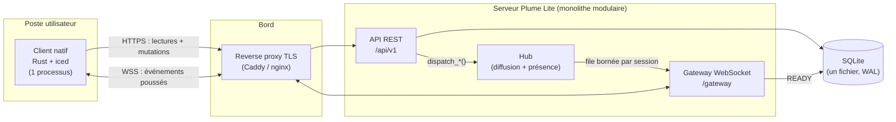
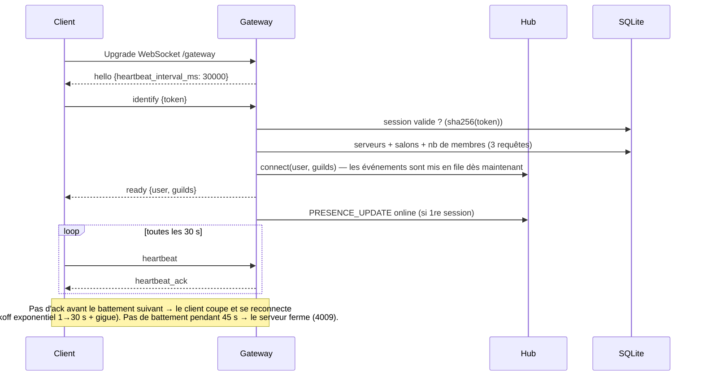
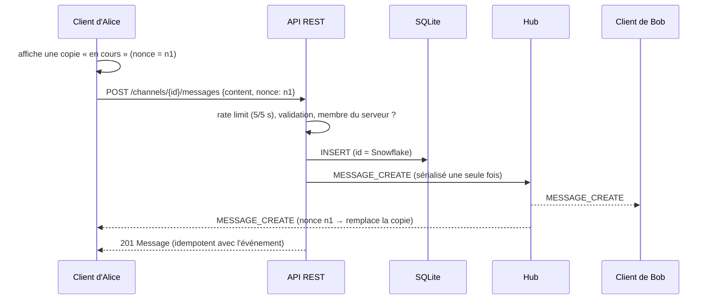
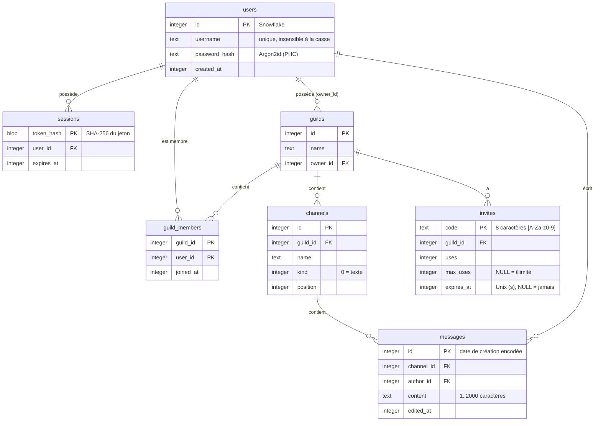

# Architecture de Plume Lite

> Une alternative à Discord la plus simple possible : un client **natif** (Rust + iced, sans
> moteur web) et un serveur Rust (axum) auto-hébergé sur un petit VPS, avec sa base de
> données dans **un seul fichier SQLite**. Pensée pour un groupe d'amis ou une petite
> communauté, pas pour des millions d'utilisateurs.

## 1. Objectifs et contraintes

| Exigence | Cible MVP | Comment on l'atteint |
|---|---|---|
| Empreinte du client | Un seul processus, ~50 Mo de mémoire propre | Rendu natif (iced/wgpu), pas de Chromium, cache borné |
| Latence temps réel | < 100 ms de bout en bout | WebSocket persistant, événements sérialisés une seule fois |
| Simplicité d'exploitation | 1 binaire + 1 fichier de base de données | Un seul processus, SQLite embarqué, migrations embarquées, config 12-factor |
| Sécurité de base | Niveau « production » | Argon2id, jetons opaques hachés, rate limiting, validation partagée |
| Hébergement | Un petit VPS partagé avec d'autres sites (2 vCPU, 4 Go) | Serveur de ~30 Mo de RAM, aucun serveur de base de données à côté |

Pas encore faits (voir la [roadmap](#13-roadmap)) : vocal, vidéo et partage d'écran,
messages privés, pièces jointes, rôles, notifications.

## 2. Vue d'ensemble



**Principe directeur (le même que Discord) :** toutes les mutations passent par REST
(simples à valider, à limiter, à rejouer, à tester), et le WebSocket ne sert qu'à **pousser**
les conséquences aux clients concernés. Le client n'envoie sur le gateway que `identify` et
`heartbeat`.

## 3. Organisation du code

```
plume-lite/
├── Cargo.toml                 # workspace (versions communes, lints, profils)
├── crates/
│   ├── protocol/              # contrat client ⇄ serveur, partagé à la compilation
│   │   └── src/{snowflake,model,http,gateway,validate}.rs
│   ├── server/
│   │   ├── migrations/        # SQL versionné, embarqué dans le binaire
│   │   ├── src/
│   │   │   ├── main.rs        # câblage : config, pool, migrations, arrêt gracieux
│   │   │   ├── lib.rs         # application réutilisée telle quelle par les tests
│   │   │   ├── routes/        # handlers HTTP fins (validation → db → hub)
│   │   │   ├── db/            # SQL par agrégat, sans ORM, sans N+1
│   │   │   ├── gateway/       # session WebSocket + hub de diffusion/présence
│   │   │   ├── auth.rs        # Argon2id, jetons, extracteur AuthUser
│   │   │   ├── ids.rs         # générateur Snowflake sans verrou
│   │   │   ├── rate_limit.rs  # token buckets
│   │   │   └── error.rs       # enveloppe d'erreur unique
│   │   └── tests/api.rs       # tests de bout en bout (HTTP + WebSocket réels)
│   └── client/
│       └── src/
│           ├── main.rs        # démarrage iced
│           ├── app.rs         # machine à états (architecture Elm)
│           ├── store.rs       # cache normalisé + réducteurs purs (testés)
│           ├── api.rs         # client REST typé
│           ├── gateway.rs     # connexion temps réel (Subscription iced)
│           ├── session.rs     # session (fichier 0600) et préférences persistées
│           ├── theme.rs       # thèmes clair (par défaut) et sombre, styles
│           └── view/          # rendu pur : login, sidebar, chat, members, modal
└── docs/
```

Le crate **`protocol`** est la pièce maîtresse : modèles, DTO REST, trames du gateway,
codes d'erreur et règles de validation sont définis **une seule fois**. Un changement de
format qui casse le client casse la compilation, pas la production.

## 4. Décisions d'architecture

| # | Décision | Alternatives écartées | Raison |
|---|---|---|---|
| 1 | **Rust de bout en bout** + crate `protocol` partagé | TS côté serveur | Un seul langage, contrat vérifié par le compilateur, binaires sobres |
| 2 | Client **iced 0.14** (architecture Elm, rendu wgpu avec repli logiciel tiny-skia) | Tauri (WebView), egui, Slint, gpui | Natif sans WebView ; modèle Elm prévisible et testable ; utilisé en production (COSMIC) ; licence MIT |
| 3 | Serveur **axum 0.8** sur tokio | actix-web | Écosystème tower (middlewares), WebSocket intégré, ergonomie |
| 4 | **SQLite** (WAL) + **sqlx** (SQL explicite) | PostgreSQL, ORM, MongoDB | Aucun serveur de base à faire tourner, sécuriser ou mettre à jour ; quelques Mo de RAM sur un VPS partagé ; sauvegarde = un fichier ; transactions, clés étrangères, tables `STRICT`, index composites. Un seul écrivain à la fois, soit des milliers d'écritures par seconde : largement assez pour une instance entre amis |
| 5 | **IDs Snowflake** (64 bits, triables par temps) | UUID v4, auto-incrément | Pagination par curseur gratuite, date de création encodée dans l'id, générés sans aller-retour en base |
| 6 | **Jetons opaques** (256 bits, seul le SHA-256 est stocké) | JWT | Révocation instantanée (logout = `DELETE`), pas de secret de signature à faire tourner ; coût = 1 lookup par clé primaire |
| 7 | **REST pour écrire, WebSocket pour diffuser** | Tout en WebSocket | Rate limiting, codes HTTP, idempotence et tests triviaux |
| 8 | **Un seul processus** (modules séparés à l'intérieur) | Microservices | Un binaire à déployer et à surveiller ; le code reste découpé par responsabilité |
| 9 | **Hub en mémoire** derrière une interface `dispatch_*` | Redis, NATS | Une seule instance par conception : un bus de messages n'apporterait rien ; un serveur Rust tient sans peine des milliers de WebSockets |
| 10 | **Envoi optimiste** avec `nonce` | Attendre la réponse | Perception de latence nulle ; réconciliation déterministe |
| 11 | **READY = point de resynchronisation** | Reprise avec numéros de séquence | Plus simple et robuste pour un MVP ; la reprise (`resume`) est sur la roadmap |

## 5. Flux principaux

### 5.1 Connexion au gateway



### 5.2 Envoi d'un message



Tous les réducteurs du client sont **idempotents** (insertion triée par id, dédoublonnage) :
peu importe l'ordre d'arrivée de la réponse REST et de l'événement, ou un événement
reçu deux fois autour d'une reconnexion.

## 6. Modèle de données



Index choisis pour les requêtes réellement exécutées :

| Requête chaude | Index | Coût |
|---|---|---|
| Page de messages avant/après X | `messages (channel_id, id DESC)` | 1 parcours d'intervalle, quelle que soit la taille de l'historique |
| Serveurs d'un utilisateur (READY) | `guild_members (user_id)` | O(nb de serveurs) |
| Membres d'un serveur (pagination par clé) | PK `(guild_id, user_id)` | Pas d'`OFFSET`, coût constant par page |
| Authentification | PK `sessions (token_hash)` | 1 lookup |
| Connexion par nom | `username UNIQUE COLLATE NOCASE` | 1 lookup, insensible à la casse |

Garde-fous en base (défense en profondeur) : tables `STRICT` (une valeur du mauvais type est
refusée), `CHECK` sur les longueurs, clés étrangères en cascade, `max_uses > 0`. Les dates
sont des timestamps Unix en secondes, comparés à `unixepoch()`. Le redeem d'une invitation est un `UPDATE … WHERE uses < max_uses
RETURNING` : atomique, donc sans course.

## 7. Le serveur

- **Couches :** `routes` (HTTP fin : extraction → validation → contrôle d'accès → `db` →
  `hub`) ; `db` (SQL par agrégat) ; `gateway` (sessions) ; `hub` (routage des événements).
- **Contrôle d'accès :** une seule requête charge un salon **et** vérifie l'appartenance
  (`db::channels::access`). Un non-membre reçoit **404** (et non 403) : impossible de sonder
  l'existence d'un serveur ou d'un salon.
- **Hub :** ne connaît que les utilisateurs **en ligne** (`user → sessions + serveurs`,
  `serveur → membres en ligne`). Publier coûte O(membres en ligne). Chaque session a une
  file bornée (512) ; un client trop lent est déconnecté (code 4008) puis se resynchronise,
  au lieu de faire gonfler la mémoire du serveur.
- **Arrêt gracieux :** SIGTERM → plus de nouvelles connexions, les sessions gateway ferment
  avec 1012 (« redémarrage ») et les clients se reconnectent avec backoff.
- **Tâches de fond :** purge des buckets de rate limiting (1 min) et des sessions expirées (1 h).

## 8. Le client

Architecture **Elm** (celle d'iced) : `état → Msg → update → (nouvel état, Tasks) → view`.

- `App` est une machine à états : `Restoring` (validation du jeton enregistré) → `Login` →
  `Chat`. Une session invalide (401 ou code gateway 4004) renvoie à `Login`.
- `Store` est un **cache normalisé** (serveurs, salons, chronologies, membres, présence,
  frappe, non-lus) alimenté uniquement par des **réducteurs purs**, testés unitairement.
- `gateway.rs` expose la connexion comme une `Subscription` iced indexée par
  `(url, jeton)` : se déconnecter la détruit, changer de compte en crée une nouvelle.
- **Sobriété mémoire :** en quittant un salon, sa chronologie est tronquée à 100 messages ;
  les messages des salons jamais ouverts ne sont pas conservés (seul l'indicateur « non lu »
  l'est) ; l'historique se charge par pages de 50 au défilement.
- **UX :** envoi optimiste avec relance/abandon en cas d'échec, regroupement des messages
  par auteur (fenêtre de 7 min), séparateurs de jour, brouillons par salon, indicateur de
  frappe (anti-rebond 8 s), édition en ligne (Entrée/Échap), présence en direct.

## 9. Sécurité

| Menace | Mesure |
|---|---|
| Vol de base de données | Mots de passe en Argon2id (paramètres OWASP), jetons stockés uniquement en SHA-256 |
| Bourrage d'identifiants | 10 tentatives/min/IP, coût Argon2, temps de réponse égalisé (utilisateur inconnu = vérification factice) |
| Déni de service par hachage | Sémaphore : au plus N hachages Argon2 simultanés (N = nb de cœurs) |
| Flood | Token buckets : 100 req/5 s/IP, 5 messages/5 s/utilisateur, frappe 5/10 s ; WebSocket : 60 trames/min, trames ≤ 4 Kio, identify en 10 s |
| Charges utiles abusives | Corps ≤ 64 Kio, timeout 15 s, validation partagée (longueurs, caractères de contrôle, octet NUL) |
| Énumération | 404 identique pour « inexistant » et « non autorisé » |
| Usurpation d'IP | `X-Forwarded-For` ignoré sauf `TRUST_PROXY=true` (et seule l'entrée la plus à droite est retenue) |
| Fuite d'informations | Erreurs internes journalisées côté serveur, message générique côté client |
| Jeton sur le poste client | Fichier de session en mode 0600 (trousseau du système sur la roadmap) |

TLS est terminé par le reverse proxy (Caddy obtient et renouvelle les certificats tout seul) ;
le client gère `https://` et `wss://` via rustls.

## 10. Une seule instance, par choix

Plume Lite tourne sur **une seule machine** : la base SQLite, le hub de diffusion, la
présence et les limites de débit vivent dans le processus du serveur. C'est ce qui le rend
simple à installer, à sauvegarder et à faire tourner à côté d'autres sites sur un petit VPS.

- **Base de données :** mode WAL (les lectures continuent pendant une écriture),
  `synchronous = NORMAL`, clés étrangères actives, attente de 5 s si la base est occupée.
  Les transactions d'écriture commencent par `BEGIN IMMEDIATE` (verrou pris d'emblée, pas
  d'échec quand une lecture devient une écriture). À l'arrêt, le journal est replié dans
  le fichier principal.
- **Capacité :** un serveur de cette taille supporte sans effort des centaines d'utilisateurs
  connectés ; la limite pratique sera la bande passante du VPS (partage d'écran) et le
  disque (fichiers), pas la base.
- **Si un jour il fallait plusieurs machines :** les handlers ne parlent qu'à
  `hub.dispatch_*` (un bus Redis/NATS pourrait s'y brancher), le SQL est explicite et
  regroupé dans `db/` (portable vers PostgreSQL), l'API est versionnée (`/api/v1`) et les
  formats tolèrent les évolutions (variantes inconnues ignorées par les anciens clients).

## 11. Observabilité

- Logs structurés `tracing` ; une ligne d'accès par requête (statut + latence) avec un
  `x-request-id` généré et renvoyé au client.
- Sondes : `GET /health` (vivacité) et `GET /health/ready` (base joignable).
- À ajouter ensuite : métriques Prometheus (connexions gateway, latence de diffusion,
  taille des files), traces OpenTelemetry, Sentry côté client.

## 12. Limites connues du MVP

- Permissions binaires : propriétaire / membre (rôles et permissions par salon : voir la roadmap).
- Pas de reprise de session gateway : chaque reconnexion repart d'un READY complet.
- La déconnexion révoque le jeton mais ne ferme pas une session gateway déjà ouverte.
- Indicateurs « non lu » non persistés (perdus au redémarrage du client).
- Liste des membres limitée à 1 000 par serveur côté client.
- Compositeur sur une ligne, pas de Markdown, pas de sélection du texte des messages
  (le bouton « Copier » couvre le besoin).
- Pas de récupération de compte (e-mail) ni de 2FA.

## 13. Roadmap

Proposition de découpage, à partir de la liste de fonctionnalités validée (identifiants A1 à
L7). Règle commune : rien ne s'anime tout seul, et ce qui est lourd (GIF, vidéos, flux
vidéo) ne se lance qu'à la demande.

| Version | Contenu |
|---|---|
| v0.2 (faite) | Renommage en Plume Lite, passage à SQLite, thème clair bleu et rose par défaut et thème sombre (K1) |
| v0.3 Mise en ligne | Inscription sur invitation (L3), administration par commandes sur le VPS (L4, A13), sauvegardes (L2), déploiement Docker + Caddy sur `plume.donrgames.fr` (L1), client Windows compilé par la CI (K3), changement de mot de passe (A9), appareils connectés (A11), avis de nouvelle version (K7) |
| v0.4 Vocal | Serveur LiveKit sur le VPS ; salons vocaux (C5, H1-H4, H6-H12) |
| v0.5 Messages | Markdown (E5), réponses (E6), mentions (E7), réactions (E8), 4 000 caractères (E9), épinglés (E10), recherche (E11), non-lus mémorisés (E4), notifications et badge (J1-J4), zone de notification (K2) |
| v0.6 Rôles et salons | Rôles et permissions (D1-D6), droits par salon simplifiés (D7), salons privés (C6), catégories (C4), renommer et réordonner (C2, C3), bannir (B4), serveur renommable avec icône (B5), transfert de propriété (B6), journal d'audit (B8), bienvenue (B10) |
| v0.7 Fichiers et profils | Pièces jointes jusqu'à 2 Go avec reprise (F1-F5), avatar (A3), pseudo (A4), statuts (A5, A6), bio et bannière (A7), emojis (B9), aperçus de liens (E12), stickers (E13), GIF (E14) |
| v0.8 Messages privés | Messages privés, groupes, amis et blocage (G1-G3), appels privés (G4) |
| v0.9 Vidéo | Caméra et partage d'écran 1080p 60 ips avec son (I1-I6) |
| v1.0 | Double authentification (A10), suppression de compte (A12), page d'état (L7), mode compact (K6), chiffrement de bout en bout du vocal (L6, à étudier) |
